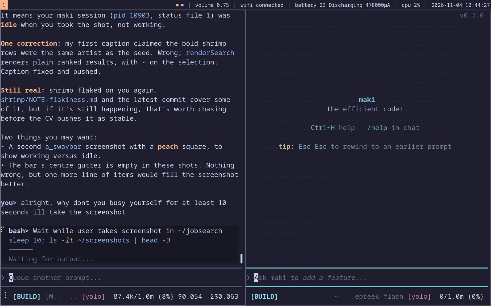

# swaybar.c

A status bar in one C file, speaking the i3bar JSON protocol to sway.



A close-up of the squares: peach is working, lavender is idle.


It shows volume, wifi, battery, CPU and the clock, and one coloured square per
[maki](https://github.com/tontinton/maki) session, ordered by the workspace that
session runs in. It replaces the shell script it grew out of.

**maki** is the agentic TUI this machine does all its work in: one process, many
sessions. The bar shows them because the alternative, switching between
workspaces to find out which agent is still working, is the thing a status bar
exists to remove.

Two colours, and one meaning each:

| square | meaning |
|---|---|
| peach | working |
| lavender | idle, or waiting for your input |

Sessions are sorted by workspace number, so the leftmost square is the session
you would reach first moving right through your workspaces.

## The two decisions

**Volume is read on a change event, not on a timer.** The bar holds a
libpulse connection and asks for source info when PulseAudio says something
changed. At rest, pipewire-pulse does no work for the bar, and the bar does no
work for volume.

**The bar does not link against maki, and maki does not spawn the bar.** maki
writes one small file per session per process (see
[maki-session-status](https://github.com/zipadoodlez/maki-session-status)). The
bar resolves a pid to a workspace through sway, then reads the file. Either side
can be rewritten or restarted alone.

The bar watches the status directory with `inotify`, so a square changes on the
next tick after maki writes, not a poll interval later. Dead processes are swept
by the bar, and maki deletes its own file on session end, so neither can leak.

## What it costs

Measured on the machine this was written on, one minute each, same conditions.
The comparison is the shell script this replaces, which sway used to run once
per second.

| | CPU over 60 s | share of one core | wakes |
|---|---|---|---|
| shell script, once per second | 1,140 ms | 1.90 % | ~60 |
| this bar | 150 ms | 0.25 % | ~60 |

About 7.6 times less CPU. 150 ms is close to the floor: a process that only
sleeps still costs something.

The old cost was almost all one `wpctl get-volume` child per second. Each call
is about 10 ms of fork, exec, connect and exit, on top of the shell that read
`/proc` and formatted the same text again every second.

The bar wakes about as often as the script did. The saving is in the work per
wake, not in the number of wakes:

- One process, not three. The libpulse connection lives as long as the bar, and
  volume is read only when PulseAudio reports a change.
- One `poll()` per tick over the pipewire fd and an `inotify` watch, instead of
  re-reading files.
- No output when nothing changed. The frame is compared and only written to sway
  when it differs, so identical ticks never force a re-layout.
- The wait is recomputed to the next whole second on every wake, so a late wake
  self-corrects. The clock never skips a second.

To measure it again: read field 14 and 15 of `/proc/<pid>/stat` for the bar, or
run the old script bounded and read its CPU time from `getrusage`.

## Build and run

```sh
make                         # builds ./swaybar
```

Then point sway's `status_command` at the absolute path, with
`tray_output none` off and `bar { status_command /path/to/swaybar }`.

The binary must not be called `swaybar` on your `PATH`: sway spawns its own
renderer under that name and yours would hijack it. Keep an absolute path.

Requires: a C compiler, `libpulse` headers (`pkg-config libpulse`), and sway.

## Other programs in the squares

Any program that can write `<state_dir>/statusbar/<pid>.status` appears the same
way. The producer is not tied to maki; the file format is the whole contract.
The screenshot above shows a search window from
[shrimp](https://github.com/zipadoodlez/shrimp) open on workspace 3 while the bar
keeps ticking.

## What it reads

- `/proc` and `/sys` for CPU and battery.
- `inotify` for changes it should react to instead of polling.
- a Unix socket for the sway `i3-ipc` state, to map pid to workspace.
